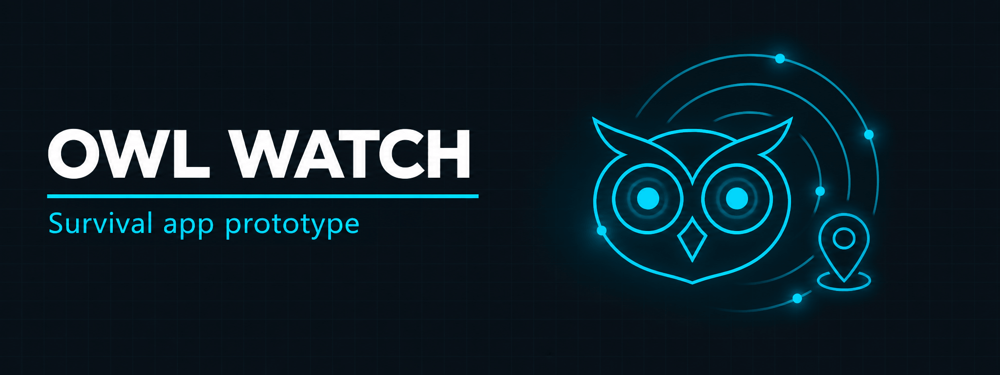

<p align="center">
  
</p>

<h1 align="center">Owl Watch</h1>

<h3 align="center">Survival app prototype with SOS alerts, offline mode and incident reporting, designed in Figma</h3>

<p align="center">
  
  
  
  
</p>

<p align="center">
  <a href="#overview"><b>Overview</b></a> ·
  <a href="#features"><b>Features</b></a> ·
  <a href="#screenshots"><b>Screenshots</b></a> ·
  <a href="#design-goals"><b>Design Goals</b></a> ·
  <a href="#built-with"><b>Built With</b></a> ·
  <a href="#repository-structure"><b>Structure</b></a>
</p>

---

## Overview

Owl Watch is a survival-first mobile app prototype that helps users in emergency situations. It combines real-time SOS alerts, map-based incident reporting, offline support and curated survival guidance, with an interface focused on usability, clarity and urgency.

The project was developed for the **Introduction to Software Engineering** course under the supervision of **Miss Maryam Wardah**.

> "When seconds matter, clarity isn't a luxury. It's survival."

| | |
| --- | --- |
| **Project** | Owl Watch, Safe Zone Survival App |
| **Type** | Mobile app prototype (UI/UX design) |
| **Tool** | Figma |
| **Course** | Introduction to Software Engineering |
| **Supervisor** | Miss Maryam Wardah |

## Features

| Feature | Description |
| ------- | ----------- |
| SOS button | Instant emergency alert with location sharing |
| Map logging | Report incidents with timestamp and location |
| Offline emergency mode | Store an SOS offline and send it automatically when back online |
| Emergency guidance | Medical, fire, road, workplace and other emergencies |
| Emergency contacts | Personal contacts and default helplines |
| Community assistance | Nearby alerts, "I'm Safe" status and help requests |
| Profile management | Address, blood group and emergency information |

## Screenshots

| | | |
| --- | --- | --- |
|  |  |  |
| <sub>Welcome screen</sub> | <sub>Home with emergency categories</sub> | <sub>SOS screen with location permission</sub> |

<p align="center">
  
</p>

<p align="center">
  <sub>Figma canvas: login and signup, side bar, menu, SOS, map and operations flows</sub>
</p>

## Design Goals

- Design an interface that works under pressure
- Create clean, intuitive flows for emergency scenarios
- Focus on offline functionality, SOS alerts and location sharing
- Build a scalable prototype architecture in Figma

## Built With

| Component | Technology |
| --------- | ---------- |
| UI/UX design | [Figma](https://www.figma.com/) |
| Prototyping | Figma interactive prototype |

## Repository Structure

```
figma-survival-app-prototype/
├── README.md
├── Owl-Watch/                # project files
├── screenshots/              # app screens and Figma canvas
└── images/                   # banner
```

## License

Shared for educational reference.

## Contact

<p align="center">
  <b>Abdul Wahid</b>
</p>

<p align="center">
  <a href="mailto:a.wahid7860668@gmail.com"></a>
  <a href="https://www.linkedin.com/in/abdul-wahid022"></a>
  <a href="https://github.com/abdul-wahid022"></a>
</p>
